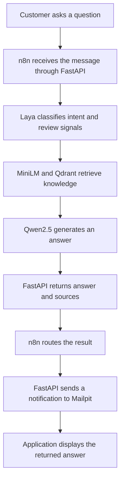
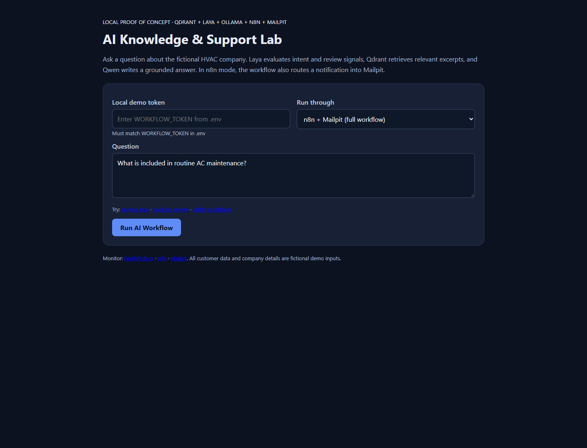
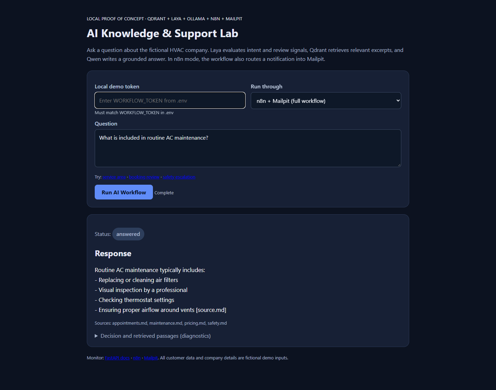
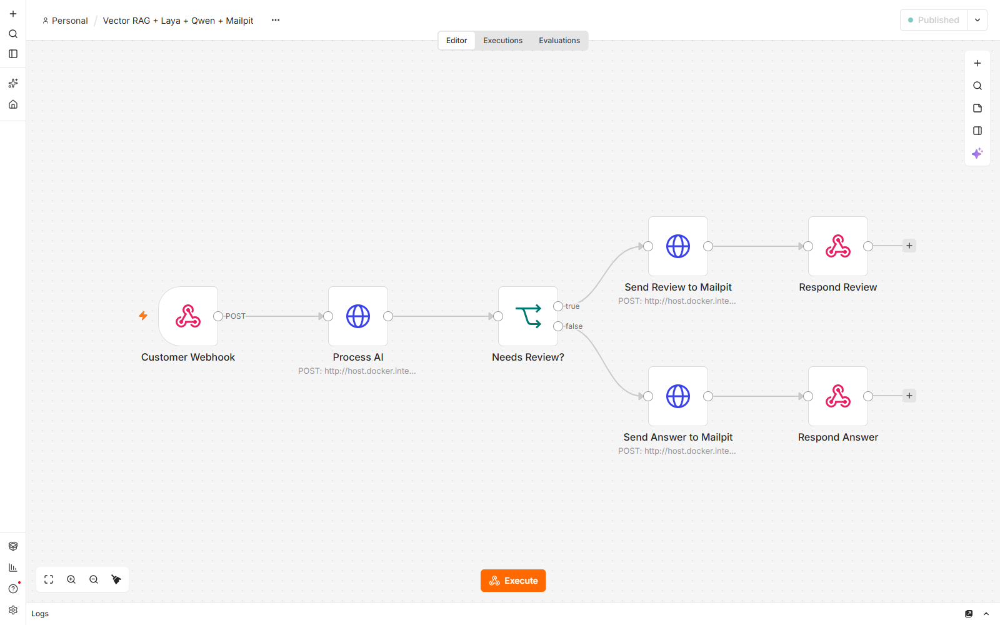
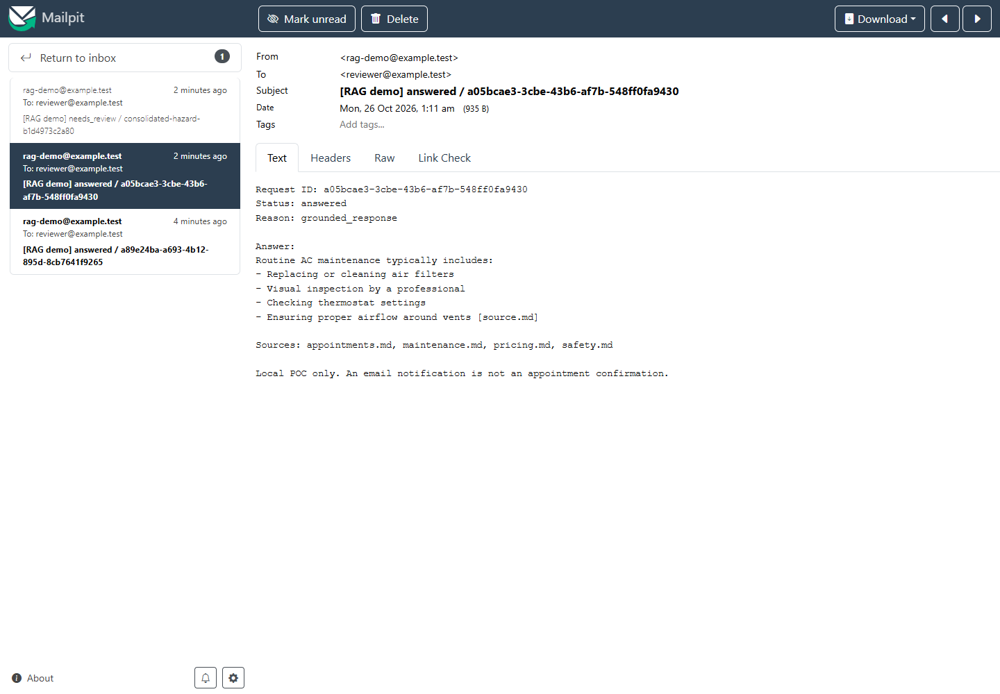

# Vector RAG + Laya AI Automation

What happens inside this project when a customer asks:

> What is included in routine AC maintenance?

Each technology has a different responsibility. **Laya** classifies what the customer wants, **MiniLM and Qdrant** find relevant knowledge, **Qwen** generates the answer, **FastAPI** enforces the application rules, and **n8n** automates the workflow. **Mailpit** captures the notification email locally.

This walkthrough follows the real maintenance test. For installation and the broader technical overview, see the [project guide](docs/PROJECT_GUIDE.md).

## Complete process flow



For the maintenance question, the observed result was `intent: maintenance`, `status: answered`, and no review flag. Requests requiring review can return earlier without generating an answer.

## Step 1 — The customer submits the question

The customer opens the application and types:

> What is included in routine AC maintenance?



*The real application before submitting the maintenance question.*

In full-workflow mode, the browser calls FastAPI's `/api/via-n8n` endpoint. FastAPI forwards the message to the configured n8n webhook:

```http
POST http://localhost:5678/webhook/rag-laya-intake
Content-Type: application/json
```

```json
{
  "message": "What is included in routine AC maintenance?"
}
```

n8n receives the message and sends it to FastAPI's `/api/process` endpoint for AI processing. At this stage, n8n coordinates the workflow; it does not answer the question itself.

## Step 2 — Laya classifies the question

FastAPI sends the customer's message to the locally running Laya model. Laya evaluates the primary intent and signals that might require human intervention.

The actual test returned these decision fields:

```json
{
  "provider": "laya-local",
  "intent": "maintenance",
  "confidence": 0.6997,
  "hazard_probability": 0.0598,
  "human_probability": 0.0951,
  "needs_review": false
}
```

This means:

- The predicted intent is maintenance, with a model confidence score of approximately 70%.
- No hazard or human-assistance signal crossed the configured review thresholds.
- The application can proceed with the normal RAG answering process.

The confidence score is a model estimate, not a guarantee of correctness. FastAPI applies deterministic policy checks alongside the model signals.

**Why use Laya?** The same system must distinguish a maintenance question from a booking request or a potentially hazardous situation. Laya produces structured decision signals rather than writing the final answer.

## Step 3 — MiniLM converts the question into a vector

FastAPI uses MiniLM to turn the question into a numerical representation called an **embedding**.

Conceptually:

```text
"What is included in routine AC maintenance?"
                      ↓
                    MiniLM
                      ↓
          [0.12, -0.28, 0.73, 0.09, ...]
```

*These numbers are illustrative, not values recorded from the test.*

During initial seeding, the knowledge documents were also converted into embeddings and stored in Qdrant. The question and stored passages can therefore be compared by semantic meaning, rather than only by matching keywords.

## Step 4 — Qdrant finds relevant knowledge

Qdrant searches its vector collection for passages most similar to the question. In the successful test, it returned:

| Document | Similarity score |
|---|---:|
| `maintenance.md` | 0.6100 |
| `safety.md` | 0.3578 |
| `pricing.md` | 0.3231 |
| `appointments.md` | 0.3221 |

The most relevant passage came from `maintenance.md`:

> Routine preventative maintenance may include replacing or cleaning suitable air filters, visual inspection by a professional, checking thermostat settings, and checking airflow around vents.

**Why Qdrant?** Instead of sending every company document to the LLM, the application retrieves a small selection of relevant passages. This improves efficiency and supplies evidence for the answer. Similarity scores measure vector similarity, not factual certainty.

## Step 5 — Qwen2.5 generates the answer

FastAPI sends the original question and retrieved passages to `qwen2.5:7b`, running locally through Ollama.

Conceptually, Qwen receives:

```text
Question:
What is included in routine AC maintenance?

Retrieved knowledge:
Routine preventative maintenance may include cleaning filters,
professional visual inspection, checking thermostat settings and airflow.

Instructions:
Answer using the supplied knowledge.
Do not invent unsupported details.
```

Qwen turns that context into a readable response. The actual answer was:

> Routine AC maintenance typically includes:
> - Replacing or cleaning air filters
> - Visual inspection by a professional
> - Checking thermostat settings
> - Ensuring proper airflow around vents [source.md]

This is the **generation** part of Retrieval-Augmented Generation (RAG).



*The real maintenance result, including the separately returned source filenames.*

**Observed limitation:** Qwen generated the invalid citation `[source.md]`. The returned source metadata was correct, but the generated citation label was not validated. The screenshot and recorded response retain this issue exactly as observed.

## Step 6 — FastAPI returns the result to n8n

FastAPI packages the answer, decision, and sources into a structured response. This is an abbreviated version of the recorded result matching the screenshots:

```json
{
  "request_id": "a05bcae3-3cbe-43b6-af7b-548ff0fa9430",
  "status": "answered",
  "decision": {
    "intent": "maintenance",
    "needs_review": false
  },
  "answer": "Routine AC maintenance typically includes...",
  "sources": [
    "appointments.md",
    "maintenance.md",
    "pricing.md",
    "safety.md"
  ],
  "reason": "grounded_response"
}
```

The complete response, including decision scores and retrieved passages, is in the [recorded maintenance evidence](docs/evidence/consolidated-maintenance.json).

n8n does not need to interpret the answer's wording. It can route the workflow using a structured field such as `status`. The label `grounded_response` indicates that the RAG path ran; it does not independently verify every claim or citation.

## Step 7 — n8n chooses the notification branch

The workflow checks:

```text
Is status == "needs_review"?
```

For the maintenance question:

```text
status = answered
        ↓
Answer branch
        ↓
Send answer notification
```

Booking requests and hazardous situations route to review instead. No branch creates a real appointment.



*The real seven-node workflow showing the answer and review branches.*

In this project, both notification branches call FastAPI's `/api/notify` endpoint. FastAPI then sends the email through SMTP; these are HTTP Request nodes, not direct n8n Send Email nodes.

## Step 8 — Mailpit receives the email

The test notification was successfully received by Mailpit. It included:

| Email field | Recorded value |
|---|---|
| To | `reviewer@example.test` |
| Subject | `[RAG demo] answered / a05bcae3-3cbe-43b6-af7b-548ff0fa9430` |
| Status | `answered` |
| Reason | `grounded_response` |
| Answer | The generated maintenance response |
| Sources | `appointments.md`, `maintenance.md`, `pricing.md`, `safety.md` |



*The real captured email, with the same request ID as the application result.*

Mailpit captures the notification locally so it can be inspected. It does not deliver a real email to an external customer. After notification succeeds, n8n returns the original processing result through FastAPI to the browser, where the customer reads the answer.

The URLs above use the default local ports. These existing screenshots were captured using isolated validation ports; the [recorded walkthrough](docs/DEMO_WALKTHROUGH.md) explains that setup.

## What if the customer asks something different?

| Customer message | Laya / application decision | Intended workflow |
|---|---|---|
| "What is AC maintenance?" | Routine knowledge question | RAG answer → notification |
| "Can I book a technician tomorrow?" | Booking request | Human review → Mailpit; no booking |
| "I smell gas near the furnace!" | Potential hazard | Safety response → review notification |
| "What is today's exact repair price?" | Pricing question | Retrieve pricing policy; do not invent a price |

Model predictions can vary. See the [tested scenario results](docs/DEMO_WALKTHROUGH.md#scenario-results) for observed outcomes, including the service-area question that unexpectedly escalated to review.

## The core idea

**Laya** supplies structured decision signals. **MiniLM and Qdrant** find what the knowledge base contains. **Qwen** explains that knowledge in natural language. **FastAPI** enforces application rules. **n8n** coordinates the next steps, and **Mailpit** makes email notifications inspectable.

Together, they demonstrate RAG integrated with AI decisions and business workflow automation.

Ready to run it? Start with [Windows installation](docs/INSTALLATION_WINDOWS.md), then [running and testing](docs/RUNNING_AND_TESTING.md). The previous overview is preserved in the [project guide](docs/PROJECT_GUIDE.md).
