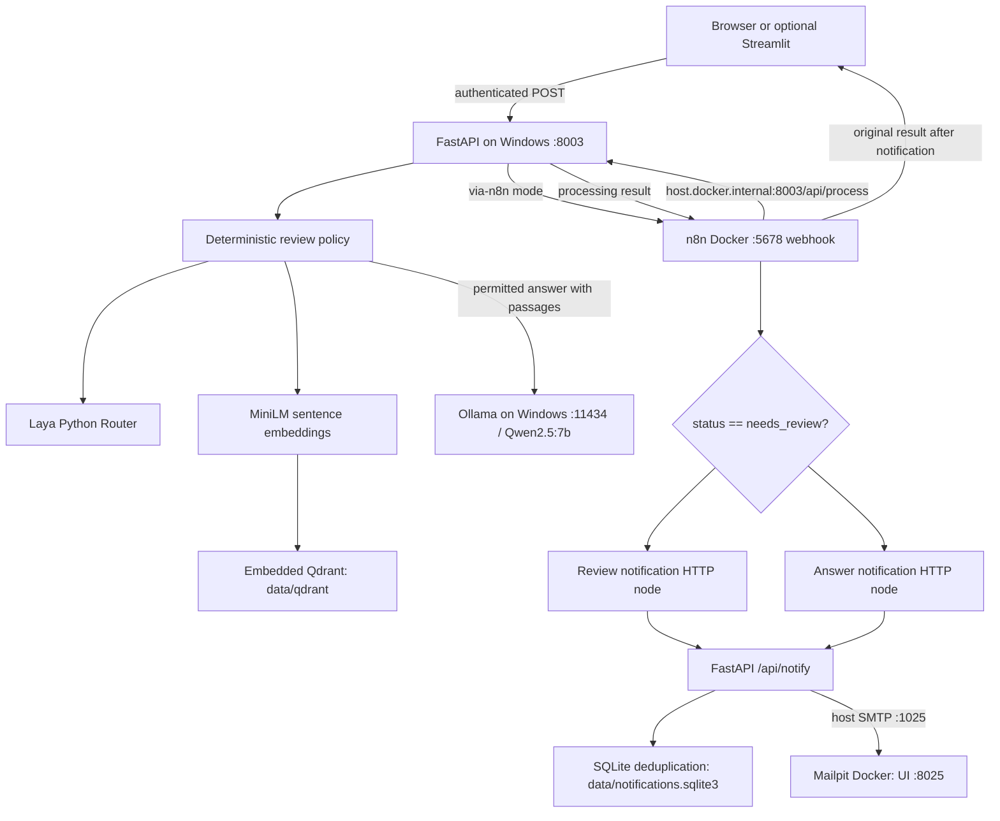

# Architecture

The proof of concept separates decision signals, deterministic routing, semantic retrieval, answer generation, and automation. These components are versioned together but external services and model checkpoints are installed separately.

The browser actually receives the n8n response through FastAPI's `/api/via-n8n` proxy. Direct mode bypasses n8n and email. Streamlit uses the same two endpoints; it is not a separate AI pipeline.

## Storage and inference

- Seven fictional `sample_docs/*.md` files are split into 680-character chunks with 110-character overlap. Filenames and chunk offsets are persisted as payloads.
- MiniLM normalizes vectors. The collection uses cosine distance; query results are limited by `TOP_K` and filtered by `MIN_RELEVANCE`.
- Qdrant is embedded, persisted locally, and single-process. API and ingestion must not open the same directory concurrently. Explicit close runs in CLI `finally` and FastAPI lifespan shutdown.
- Initialization creates a missing collection and skips an existing one. It does not update existing content. For a new corpus/embedding model, stop the API and choose a new `QDRANT_COLLECTION` name.
- Laya is a Python decision model, not an Ollama tag. A cached `Router` returns intent/confidence and hazard/human signals. Keyword checks supplement those signals. Low/missing confidence and review flags prevent answer generation.
- Ollama provides local Qwen2.5:7b text generation using retrieved passages and a constrained prompt. A request uses nonstreaming `/api/chat`, temperature 0.2, and up to 300 generated tokens.
- Notification deduplication uses a SQLite primary key on request ID and an in-process lock. SMTP and SQLite are not an atomic distributed transaction; a crash between send and commit can cause replay duplication.

## Network topology

| Caller | Destination | Purpose |
|---|---|---|
| Browser | `localhost:8003` | UI and same-origin API |
| FastAPI | `localhost:5678/webhook/rag-laya-intake` | full automation |
| n8n container | `host.docker.internal:8003` | process and notify |
| FastAPI | `127.0.0.1:11434` | Ollama |
| FastAPI | `127.0.0.1:1025` | SMTP published by Mailpit |
| Browser | `localhost:8025` | inspect captured email |

The Compose bridge connects the two supporting services, although email is sent via Windows rather than container-to-container SMTP. Model caches reside outside the repository by default; only integration code is versioned.

## Tradeoffs

Embedded storage simplifies local setup but rules out multiple API workers on the same store. CPU inference avoids a GPU prerequisite but can be slow, particularly on first load. Plain local HTTP and a shared demo token suit a trusted development machine, not internet exposure. The workflow serializes notification before returning a result, so SMTP failure can fail the overall webhook even after successful AI processing. There is no durable queue or compensating transaction.

Future server-based Qdrant, worker isolation, authenticated intake, durable retries, measured model evaluation, and claim-level grounding should be introduced deliberately rather than making a fully containerized AI stack a prerequisite for this POC.
