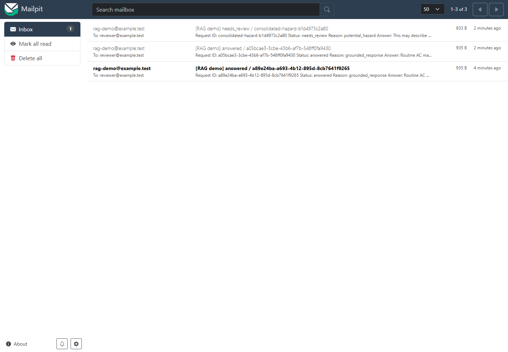
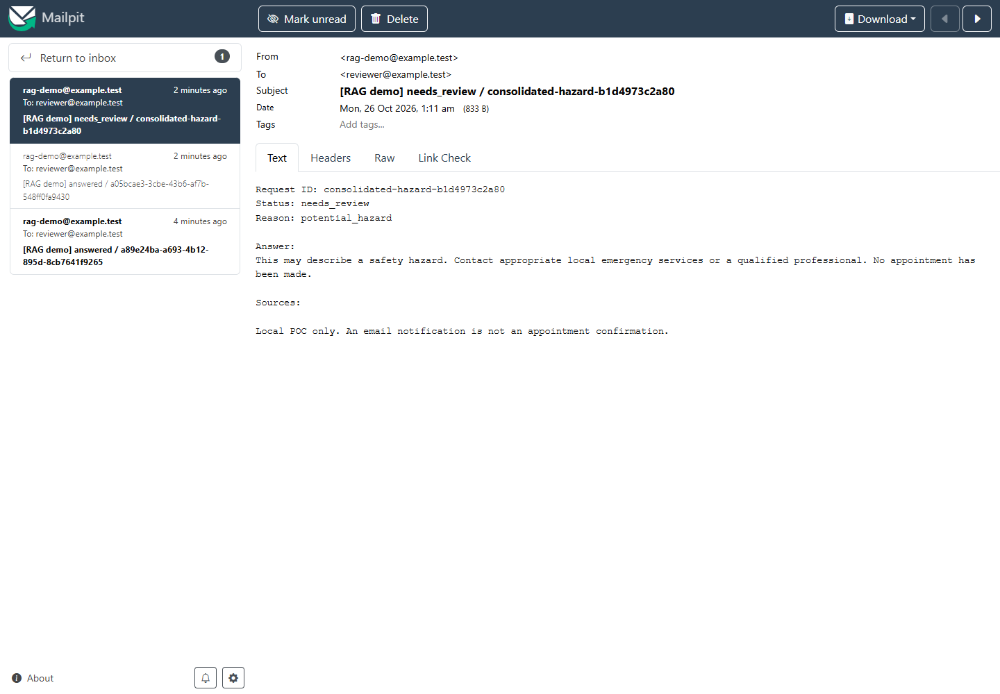

# Mailpit integration

Mailpit captures SMTP locally for inspection. No external SMTP relay, real customer recipient, appointment system, or customer email provider is configured by this project. Demo addresses use the reserved `.test` domain.

The workflow's selected notification node posts the original AI result to protected FastAPI `/api/notify`. Python validates request ID/status, checks SQLite, constructs a plain-text message, opens SMTP at `SMTP_HOST:SMTP_PORT`, sends it, and records successful delivery. The response indicates `notified` or `deduplicated`.

| Setting | Windows backend | Fresh Mailpit container |
|---|---|---|
| SMTP | `127.0.0.1:1025` | port 1025 published on host loopback |
| Web/API | browser at `localhost:8025` | port 8025 published on host loopback |
| Persistence | notification IDs in `data/notifications.sqlite3` | messages in named volume `/data/mailpit.db` |

Email subject: `[RAG demo] answered / <request_id>` or `[RAG demo] needs_review / <request_id>`. Body includes request ID, status, reason, answer, source filenames, and the explicit POC/no-confirmed-booking statement. Hazard requests can legitimately have no sources because policy returns before retrieval.

```powershell
.\scripts\test_mailpit.ps1
Invoke-RestMethod http://localhost:8025/api/v1/messages
```

The test checks receipt using a unique synthetic ID. For a RAG-generated message, run the maintenance webhook scenario and locate the matching request ID in the inbox. Open it to inspect the answer and sources. See the [walkthrough](DEMO_WALKTHROUGH.md) and [screenshot captions](screenshots/README.md).

Deduplication is keyed only by request ID, irrespective of message content or status. Reuse an ID only to replay the same logical request. The in-process lock plus SQLite transaction is sufficient for the single-process demo, not exactly-once delivery across crashes/replicas. SMTP and SQLite commit are separate operations. No automatic retry queue or reconciliation process is implemented.

For connection refusal, inspect `docker ps` for `127.0.0.1:1025->1025/tcp`; set `SMTP_PORT` to the actual host port and restart FastAPI. A Mailpit web page on 8025 alone does not prove SMTP is published. Review the n8n notification node if AI processing succeeded but the webhook failed.

Mailpit's UI/API is unauthenticated and loopback-only in the template. Email bodies may contain user text; use fictional inputs for a public demonstration and review screenshots before committing. Official references: [Docker setup](https://mailpit.axllent.org/docs/install/docker/), [persistent email storage](https://mailpit.axllent.org/docs/configuration/email-storage/), [Mailpit API](https://mailpit.axllent.org/docs/api-v1/).



*The isolated validation inbox contains real maintenance and safety test notifications.*


*The maintenance email includes the matching request ID, answered status, generated text, and retrieved filenames. The invalid `[source.md]` citation is retained as observed evidence.*



*A gas-odor request produced a real `potential_hazard` review notification without generating troubleshooting instructions.*
