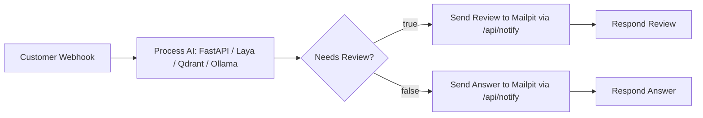
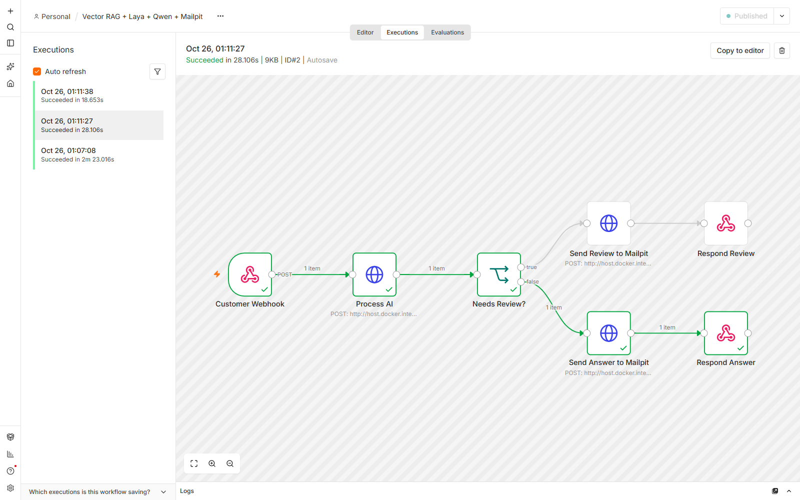
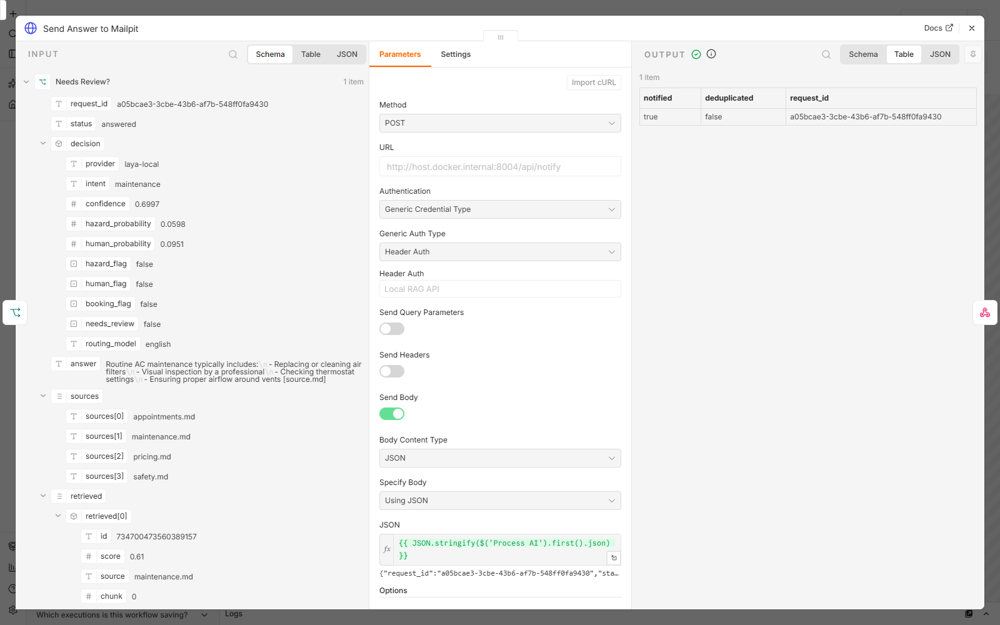

# n8n integration

The canonical [workflow export](../n8n/rag-laya-mailpit.json) has seven nodes and matches the existing RAG workflow's routing. The public version removes inline tokens, instance metadata, local credential references, and pinned execution data. It is inactive until you configure and publish it.

## Import and credentials

1. Open <http://localhost:5678>. Complete local owner setup on a fresh instance, or sign in to the existing one.
2. Create a workflow, choose **Import from file**, and select `n8n/rag-laya-mailpit.json`.
3. Create one **Header Auth** credential. Header name: `X-Demo-Token`. Header value: your local `WORKFLOW_TOKEN` from `.env`. Give it a recognizable name such as `Local RAG API`.
4. In **Process AI**, **Send Review to Mailpit**, and **Send Answer to Mailpit**, select that credential under Authentication → Generic Credential Type → Header Auth. No raw token needs to be stored in node parameters.
5. Confirm URLs use `http://host.docker.internal:8003`. Save and publish/activate the workflow. The exact UI label depends on the n8n version. Ensure another active workflow is not using the same path.

Header Auth is n8n's supported mechanism for a named authentication header; see [official HTTP Request credential documentation](https://docs.n8n.io/integrations/builtin/credentials/httprequest/). No environment-expression access or globally relaxed n8n security setting is required.

## Node reference

| Node | Configuration and role |
|---|---|
| Customer Webhook | POST `rag-laya-intake`, response via Respond to Webhook node; body has `message` and optional `request_id` |
| Process AI | POST `/api/process`; maps `$json.body.message` and optional ID; Header Auth; 180-second timeout |
| Needs Review? | Strict string comparison: `status` equals `needs_review`; true is review, false is answer |
| Send Review to Mailpit | POST `/api/notify` with the original Process AI JSON; Header Auth |
| Send Answer to Mailpit | Same notification endpoint/body, on the answer branch |
| Respond Review | Returns the original Process AI object as JSON, HTTP 200 |
| Respond Answer | Same response on the answer branch |

The IF node does not inspect natural-language output or authorize actions. Both branches send operator notifications. The actual SMTP operation is implemented in Python, not an n8n Send Email node. Notification failure stops that branch before the response node; there is no separate error workflow or durable retry queue in this release.



## Production and test URLs

Published local URL: `http://localhost:5678/webhook/rag-laya-intake`.
Test URL: `http://localhost:5678/webhook-test/rag-laya-intake`, available only while **Listen for test event** / manual test execution is active.

```powershell
.\scripts\test_webhook.ps1
.\scripts\test_webhook.ps1 -TestMode
```

The intake webhook is intentionally unauthenticated in this local POC. `X-Demo-Token` protects FastAPI, but does not protect the separately exposed n8n intake. Compose publishes n8n only on loopback. Do not expose it publicly; production needs authenticated intake, rate limits, trusted request-ID handling, HTTPS, and service-specific authorization.

## Network diagnostics

```powershell
docker exec fieldflow-n8n-demo-n8n-1 node -e "fetch('http://host.docker.internal:8003/healthz').then(r=>r.text()).then(console.log).catch(console.error)"
```

Use your actual container name (`docker ps`) on a fresh installation. `localhost` inside n8n means its container, not Windows. A 401 usually means a mismatched credential; 404 on the webhook usually means it is not published or the test listener has expired. A 500/timeout requires checking the execution node and API logs, including SMTP failures. Cold model downloads should be warmed by a direct request first.

See [screenshots](screenshots/README.md), [the recorded walkthrough](DEMO_WALKTHROUGH.md), and [validation scope](VALIDATION.md). Manual import is the supported installation path. Isolated test-instance setup used during repository validation is not a packaged automatic provisioning feature.


*The sanitized seven-node workflow imported into a fresh local validation instance.*



*Maintenance execution #2 succeeded, following the answer/false branch.*



*The actual notification response confirms `notified:true` for the same request ID shown in the browser and Mailpit.*
