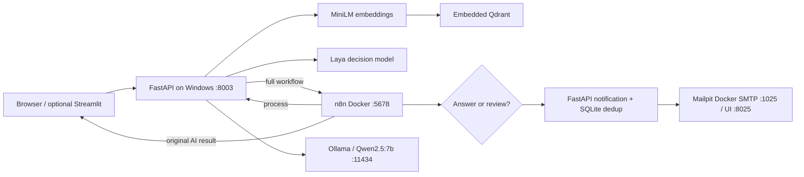

# Project overview and setup guide

For a step-by-step explanation of a real customer question, read [the main README](../README.md). This guide covers the broader architecture, installation, testing, and technical references.

A local AI engineering proof of concept that answers questions from a fictional HVAC knowledge base and routes answer/review notifications through n8n into Mailpit. It combines semantic search, a specialized decision model, local LLM inference, deterministic review policy, and event-driven automation in one repository.

No paid inference API is required. No action books an appointment or emails a real customer.

## What it demonstrates

- **RAG:** MiniLM embeds Markdown passages and questions; embedded Qdrant retrieves relevant evidence for Qwen2.5:7b.
- **Decision models:** Laya returns intent and hazard/human signals separately from answer generation.
- **Safe workflow boundaries:** deterministic rules route booking, hazard, uncertainty, and unavailable-model cases to review.
- **Local inference:** Ollama serves Qwen on Windows; Laya and MiniLM run in Python.
- **Automation:** n8n receives a webhook, calls FastAPI, branches on status, invokes notification, and returns the original result.
- **Email testing:** Python sends operator notifications into Mailpit with request ID, status, answer, and sources.
- **Reproducibility:** supporting-service Compose, PowerShell setup/start/stop/check scripts, sample documents, offline tests, CI, and technical documentation.

## Architecture



The [architecture guide](ARCHITECTURE.md) explains responsibilities, storage, networking, and tradeoffs; [request lifecycle](HOW_IT_WORKS.md) includes the full sequence diagram.

## Quick start — Windows

Prerequisites: Python 3.12 (64-bit), Git, Docker Desktop with Linux containers, Ollama, internet for initial downloads, and enough storage/RAM for Qwen, Laya, and MiniLM. GPU is optional; CPU cold starts may be slow.

```powershell
git clone https://github.com/mjaouni/vector-rag-laya-ai-automation.git
cd vector-rag-laya-ai-automation
.\scripts\setup.ps1
ollama pull qwen2.5:7b
# Fresh machine only; reuse existing n8n/Mailpit if their ports are occupied:
docker compose -f docker/compose.yaml up -d
.\.venv\Scripts\python.exe scripts/doctor.py --require-model
.\scripts\seed.ps1
.\scripts\start.ps1 -OpenBrowser
```

Open n8n at <http://localhost:5678>, import [the workflow](../n8n/rag-laya-mailpit.json), and select one Header Auth credential (`X-Demo-Token` = your `.env` `WORKFLOW_TOKEN`) in all three HTTP Request nodes. Save/publish it. Enter the same token into the browser at <http://localhost:8003> and submit:

> What is included in routine AC maintenance?

Inspect the generated response, decision/retrieval diagnostics, n8n execution, and Mailpit at <http://localhost:8025>. The full [Windows installation guide](INSTALLATION_WINDOWS.md) covers exact settings, model downloads, credential setup, and optional Streamlit. Import is manual; automatic workflow provisioning is not a supported feature.

Embedded Qdrant permits one process per directory. Seed with the API stopped. Existing collections are preserved; use a new collection name to index changed documents/models.

## Real demonstration and screenshots

The actual observed runs and their limitations are recorded in the [demonstration walkthrough](DEMO_WALKTHROUGH.md) and [validation report](VALIDATION.md). Screenshot provenance and captions are in the [screenshot index](screenshots/README.md). All published captures use real running interfaces, with fictional demo input.


*The application served by FastAPI, before submitting the maintenance question.*


*Laya classified maintenance and Qwen generated a response. The visible `[source.md]` citation is an observed limitation; see the walkthrough.*


*The actual seven-node workflow in an isolated fresh n8n instance, using the consolidated backend on alternate validation ports.*


*Mailpit received the real test email with request ID, status, generated answer, and retrieved source list.*


## Technology choices

| Technology | Role and reason |
|---|---|
| FastAPI / Pydantic | One typed HTTP backend and browser entry point |
| Laya | Specialized structured decision signals, separate from text generation |
| MiniLM / SentenceTransformers | Compact local semantic embeddings |
| Qdrant embedded | Persistent cosine vector search without an extra server |
| Ollama / Qwen2.5:7b | Local answer generation through a standard HTTP inference service |
| n8n | Visible webhook orchestration and conditional routing |
| Mailpit | Inspectable local SMTP capture without sending customer email |
| SQLite | Small persistent notification deduplication ledger |
| PowerShell / Docker Compose | Repeatable Windows setup and supporting-service lifecycle |
| pytest / Ruff / GitHub Actions | Model-free regression checks and repository validation |
| Streamlit (optional) | Alternate UI calling the same backend |

## Run and test

```powershell
.\scripts\test_api.ps1
.\scripts\test_webhook.ps1
.\scripts\test_mailpit.ps1
.\.venv\Scripts\python.exe -m pytest -q
.\.venv\Scripts\python.exe -m ruff check api.py app.py cli.py service scripts tests
.\.venv\Scripts\python.exe scripts/validate_repo.py
.\scripts\stop.ps1
```

The first command bypasses n8n/email. The second exercises the full published workflow. The SMTP check verifies local delivery separately. Offline unit tests need no model weights or Docker services; CI installs [requirements-ci.txt](../requirements-ci.txt).

For foreground Uvicorn and graceful Ctrl+C shutdown, test-webhook mode, startup reuse rules, and safe Compose shutdown, see [running and testing](RUNNING_AND_TESTING.md).

## Documentation and project layout

| Path / guide | Contents |
|---|---|
| `api.py`, `web.html`, `app.py`, `cli.py` | Canonical HTTP/browser, optional Streamlit, ingestion entry points |
| `service/` | Configuration, decisions, retrieval, generation, policy, notifications |
| `sample_docs/` | Seven fictional HVAC knowledge documents |
| `n8n/` | Sanitized importable workflow and import README |
| `docker/` | Fresh-install n8n/Mailpit Compose template |
| `scripts/`, `tests/`, `.github/workflows/` | Windows lifecycle, diagnostic/test tools, offline suite, CI |
| [Investigation](INVESTIGATION.md) | Existing setup and reasons for consolidation changes |
| [Installation](INSTALLATION_WINDOWS.md) / [Running](RUNNING_AND_TESTING.md) | Clone, configure, start, test, stop |
| [n8n](N8N_INTEGRATION.md) / [Mailpit](MAILPIT_INTEGRATION.md) | Node reference, credentials, webhooks, SMTP lifecycle |
| [API reference](API_REFERENCE.md) | Actual routes, schemas, authentication, errors |
| [Troubleshooting](TROUBLESHOOTING.md) | Storage locks, ports, webhook 404, networking, model failures |
| [Security and limitations](SECURITY_AND_LIMITATIONS.md) | Local trust assumptions and production gaps |
| [Licensing](LICENSING.md) | Ownership confirmation and external dependency boundaries |

## Limitations and future work

The local intake webhook and UI are unauthenticated; the shared FastAPI token is a demo control. Compose binds n8n/Mailpit to loopback, while Docker-to-host FastAPI access requires an all-interface bind and host firewall protection. Do not expose this POC publicly.

Laya can over-escalate, similarity is not entailment, and generated filename citations are not independently verified. Review means a review outcome was produced, not that a person acted on it. There is no booking system, real customer email, durable retry queue, distributed exactly-once guarantee, or measured production safety evaluation.

Useful next steps are authenticated intake, independent citation/claim checking, measured decision/abstention evaluations, durable notification retries, explicit human approval, and server-based Qdrant when concurrency requires it. See the [security guide](SECURITY_AND_LIMITATIONS.md) before extending deployment.

Published without an application license at the owner's request. No third-party application source or model weights are included. See [licensing](LICENSING.md).
